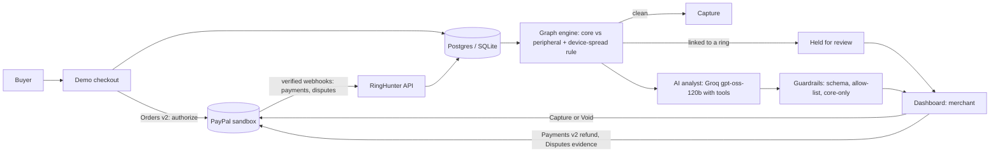

# RingHunter

**Stops coordinated buyer rings at checkout, before any money moves. An AI analyst explains each case, and the merchant approves every action.**

Built for the PayPal AI Hackathon. PayPal **sandbox only**; no real money moves.

**Live demo:** https://ringhunter.onrender.com (free tier: the first load can take about a minute to wake) · **Dashboard:** `/dashboard` · **API docs:** `/docs`

## The problem
Small merchants lose money to rings of accounts that share devices and addresses and buy or dispute in coordinated bursts. PayPal shows each payment on its own, so the pattern is easy to miss, and acting on a hunch can punish honest customers.

## What it does
1. **Authorize first.** The demo checkout uses PayPal Orders v2 with `intent=AUTHORIZE`: the buyer's funds are reserved, nothing is charged yet. It also records the device and IP that PayPal does not expose.
2. **Screen before capture.** The buyer is linked to existing accounts in a graph. If they share a **device or card** with a flagged ring, the order is **held for review**. Otherwise it is captured automatically. Holding costs the merchant nothing: no money has moved.
3. **Merchant decides.** Held orders appear on the dashboard with the reason. **Capture** charges the buyer; **Void** releases the hold. Voided money never left the buyer.
4. **Strong versus weak evidence.** Accounts sharing a device or card are **core**. Accounts linked *only by address or IP* are **peripheral** and are never held or refunded, so families and offices are left alone.
5. **AI analyst.** For a flagged case, a tool-using model inspects accounts and writes a structured finding: evidence, caveats, recommended actions (hold accounts, refund payments).
6. **Approve to act.** Hold accounts and refund payments (real PayPal refunds) only after approval. Held buyers are blocked *before* capture on later orders.
7. **Disputes connected.** Verified PayPal dispute webhooks are stored and linked to the buyer, show whether they belong to a ring, and the merchant can send evidence to PayPal after approval.

## Does it work? (self-test)
The dashboard has a **Self-test** button (and `GET /api/eval`). It generates synthetic rings and innocent look-alikes and replays them through the same hold rule the live checkout uses. 20 deterministic trials per scenario:

| Scenario | Follow-up buyers blocked |
|---|---|
| Same device, buying within minutes | 100% |
| Same device + shared address, within minutes | 100% |
| Same device, spread over days | 66% (was 0% before we added the device-spread rule) |
| Chain: neighbours share a device or address | 56% |
| Rotating devices, shared address only | 0% (known blind spot; address alone is deliberately too weak to hold anyone) |

| Innocent look-alike | Groups with a wrongly held order |
|---|---|
| Strangers; office (shared IP); family (shared address); roommates; family tablet (one device, one address, days apart) | 0% in all five |

(A bug in our first version of the chain scenario made it measure the wrong thing; it was found, fixed and re-run, which moved that row from 44% to 56%.)

The evaluation exposed that a ring which slows down evaded the timing signal. We added one rule (a device used by 3+ accounts that ship to 3+ different addresses is held for review), and the table shows the before and after. **These are our own synthetic scenarios, not real traffic. The first buyer in a ring can never be blocked, because nothing links them yet.**

## AI red team: attacks we did not write
A self-test written by the same author as the detector is circular, so the dashboard also has an **AI red team**. A separate model (the same Groq model, prompted only as an adversary) is told what the detector can observe (device, address, IP, purchase times) and asked to invent six evasion strategies. Its output is validated against a fixed schema (bounded sizes, allowed modes only), each strategy is replayed against the live hold rule, and the dashboard reports what got through, with a short AI commentary on which extra signal might catch it. Live runs are public but rate-limited (90 seconds between runs, 40 per day) to protect the free model quota; in between, the most recent result stays on screen. The model never touches checkout, the database or PayPal. With no key, or if the call fails, an offline sample set (written by us, and labelled as such) is shown instead. In our offline sample, 3 of 6 strategies evade the detector (for example, rotating devices with no other link), and we show that rather than hide it.

## Architecture


## PayPal APIs used
- **Orders v2:** create (authorize or capture intent), get, authorize, capture.
- **Payments v2:** capture an authorization, void an authorization, refund a capture, with `PayPal-Request-Id` for idempotency.
- **Webhooks:** `verify-webhook-signature` on every event; payment and dispute events are stored.
- **Disputes v1:** get dispute, provide evidence, send message.

Money-moving calls (authorize, capture, void, refund, dispute evidence) use our own guarded REST client. The **PayPal Agent Toolkit** (v1.11.0, its framework-free core installed with `--no-deps`, without the LangChain and CrewAI extras) powers the AI analyst's read-only lookups of live disputes and orders, restricted to accounts in the case. Its tool list (create, get and pay orders; disputes list, get and accept; invoices; shipments; subscriptions) has no authorization void or capture and no dispute-evidence call, which is why those stay on REST. If the toolkit is not installed or a call fails, the same lookup uses REST, and the case file lists which tools were used and through which path.

## How the AI is used
- **Investigator agent:** a tool-calling loop over `openai/gpt-oss-120b` (Groq, OpenAI-compatible API). Tools return account details and transactions for accounts in the case only.
- **Red team:** a model invents evasion strategies from a schema; we replay them against the detector (see above).
- **Evidence drafting:** the model writes a short factual dispute note from the merchant's own records, and is told never to invent shipping, tracking or policy claims.
- **Safe by construction:** model output is untrusted.
  - It is validated against a schema.
  - Actions must come from an allow-list.
  - Account IDs must belong to the case.
  - Hold and refund are clamped to **core** accounts in code, whatever the model says.
  - Standard caveats ("heuristic, not proof of fraud") are always appended.
  - If the model fails, the app falls back to a single-shot answer, then to a deterministic offline analyst. It never blocks the merchant.
- The ring *detection* and the hold rule are deterministic graph logic. The AI explains and recommends; it does not decide who is held.
- **Nothing moves without approval.** State-changing endpoints require an admin token, are idempotent, and every action is logged. Account identifiers are sticky (first-seen device, IP and address are kept), so a returning buyer cannot shake ring links by switching browser.

## Testing instructions for judges
- **No login needed:** open `/dashboard#watch`, pick a scenario and press **Replay**. It walks an attack (or an innocent group) through the live hold rule purchase by purchase, in plain language. Then **Run evaluation** for the measured results.
- Open `/dashboard`. Reading is public; actions need the **admin token** given in the Devpost testing-instructions field (sandbox only).
- Click **Run evaluation** to see the self-test. Click **Load demo data** for a ready-made ring, then **Investigate with AI analyst**.
- To make a live ring, buy at `/?device=ring1` with sandbox buyers (credentials in the Devpost field). The first buyer is charged; later buyers on the same device are held and appear under **Orders held for review**. Try **Void** and **Capture**.
- Approve an action. Refunds are real PayPal sandbox refunds. Try buying again as a held buyer: the order is declined before capture.

## Run locally
```bash
pip install -r requirements.txt
cp .env.example .env     # add PayPal sandbox keys; optionally GROQ_API_KEY; SCREENING=on for authorize-then-screen
uvicorn app.main:app --reload
# open http://localhost:8000/dashboard  and  /docs
python -m pytest -q
python -m app.llm_check  # checks your LLM key and model
python -m app.auth_check # sandbox check for authorize / void / capture
```
Without any keys, detection and the offline analyst still run. Set `ADMIN_TOKEN` to lock state-changing endpoints (leave it empty locally). `SCREENING=on` switches checkout to authorize-then-screen; the default is the plain capture flow.

## Tools and stack
Python, FastAPI, SQLAlchemy (SQLite locally, Postgres on Render), networkx, PayPal REST APIs, Groq (`openai/gpt-oss-120b`), AG Grid Community (dashboard tables), Render (hosting). Tests: pytest.

## Prior work disclosure
`app/detection_core.py` (the graph scoring engine) comes from the author's earlier project, **Abuse-Ring Sentinel**, and is reused as is. Everything else was written for this hackathon: the PayPal integration, authorize-screen-capture checkout, webhooks, dispute handling, the device-spread rule, the AI investigator and its guardrails, the approval, refund, void and hold flows, the held-buyer block, the admin lock, the dashboard, the self-test and the tests.

## Limitations (honest)
- Detection is heuristic scoring, not proof of fraud. A patient adversary who rotates devices and addresses can evade it (see the blind spot above).
- The first buyer in a ring is always charged; the system protects against the follow-up buyers.
- PayPal does not give merchants device or card fingerprints, so the demo checkout captures device and IP itself. The device ID comes from the browser (or `?device=` in the demo), which an attacker can change. Production would need real device fingerprinting.
- Self-test results come from our own synthetic scenarios.
- Sandbox data is synthetic, and all sandbox buyers share PayPal's default shipping address. That is why address-only links are treated as weak evidence.
- Evidence notes only claim shipping when the merchant supplies real tracking.
- The public demo runs on a free tier and sleeps when idle.

## License
MIT
