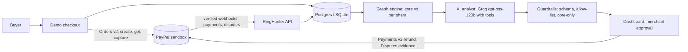

# RingHunter

**An AI analyst that finds coordinated abuse rings in a merchant's PayPal activity, writes the case file, and acts on it only with the merchant's approval.**

Built for the PayPal AI Hackathon. PayPal **sandbox only**; no real money moves.

**Live demo:** https://ringhunter.onrender.com (free tier: the first load can take about a minute to wake) · **Dashboard:** `/dashboard` · **API docs:** `/docs`

## The problem
Small merchants lose money to rings of accounts that share devices, cards and addresses and buy or dispute in coordinated bursts. PayPal shows each payment on its own, so the pattern is easy to miss, and acting on a hunch can punish honest customers.

## What it does
1. **Collects the signals PayPal does not expose.** A demo checkout (PayPal Orders v2) records device and IP next to PayPal's payer and shipping data.
2. **Links accounts as a graph.** Shared device, card, address and IP create evidence-weighted edges; timing and cluster size add to the score.
3. **Separates strong from weak links.** Accounts sharing a *device or card* are **core**. Accounts linked *only by address or IP* are **peripheral** and are never held or refunded. This keeps a family or an office from being flagged.
4. **An AI analyst writes the case file.** It inspects accounts with tools, then returns a structured finding with evidence, caveats and recommended actions.
5. **The merchant approves each action.** Hold accounts, refund payments (real PayPal refunds), or note a follow-up. Held buyers are blocked *before* PayPal capture, so no money moves.
6. **Disputes are connected.** Verified PayPal dispute webhooks are stored and linked to the buyer, show whether the buyer is in a ring, and the merchant can send evidence to PayPal after approval.

## Architecture


## PayPal APIs used
- **Orders v2:** create order, get order (to block held payers before capture), capture.
- **Payments v2:** refund a capture, with `PayPal-Request-Id` for idempotency.
- **Webhooks:** `verify-webhook-signature` on every event; payment and dispute events are stored.
- **Disputes v1:** get dispute, provide evidence, send message.

## How the AI is used
- **Investigator agent:** a tool-calling loop over `openai/gpt-oss-120b` (Groq, OpenAI-compatible API). Tools return account details and transactions for accounts in the case only.
- **Evidence drafting:** the model writes a short factual dispute note from the merchant's own records, and is told never to invent shipping, tracking or policy claims.
- **Safe by construction:** model output is untrusted.
  - It is validated against a schema.
  - Actions must come from an allow-list.
  - Account IDs must belong to the case.
  - Hold and refund are clamped to **core** accounts in code, whatever the model says.
  - Standard caveats ("heuristic, not proof of fraud") are always appended.
  - If the model fails, the app falls back to a single-shot answer, then to a deterministic offline analyst. It never blocks the merchant.
- **Nothing moves without approval.** One endpoint changes state or spends money, it is idempotent, and every action is logged.

## Testing instructions for judges
- Open the dashboard at `/dashboard`. Reading is public; actions need the **admin token** given in the Devpost testing-instructions field (sandbox only).
- Click **Load demo data** to see a ready-made ring, then **Investigate with AI analyst** and review the case file.
- To make a live ring, buy at `/?device=ring1` with two or more PayPal sandbox buyers (credentials in the Devpost field), then **Run detection**.
- Approve an action. Refunds are real PayPal sandbox refunds. Try buying again as a held buyer: the order is declined before capture.

## Run locally
```bash
pip install -r requirements.txt
cp .env.example .env     # add PayPal sandbox keys; optionally GROQ_API_KEY
uvicorn app.main:app --reload
# open http://localhost:8000/dashboard  and  /docs
python -m pytest -q
python -m app.llm_check  # checks your LLM key and model
```
Without any keys, detection and the offline analyst still run. Set `ADMIN_TOKEN` to lock state-changing endpoints (leave it empty locally).

## Tools and stack
Python, FastAPI, SQLAlchemy (SQLite locally, Postgres on Render), networkx, PayPal REST APIs, Groq (`openai/gpt-oss-120b`), AG Grid Community (dashboard tables), Render (hosting). Tests: pytest.

## Prior work disclosure
`app/detection_core.py` (the graph scoring engine) comes from the author's earlier project, **Abuse-Ring Sentinel**, and is reused as is. Everything else was written for this hackathon: the PayPal integration, checkout, webhooks, dispute handling, the AI investigator and its guardrails, the approval and refund flow, the held-buyer block, the admin lock, the dashboard and the tests.

## Limitations (honest)
- Detection is heuristic scoring, not proof of fraud. A patient adversary who staggers behaviour can evade it.
- PayPal does not give merchants device or card fingerprints, so the demo checkout captures device and IP itself. The device ID comes from the browser (or `?device=` in the demo).
- Sandbox data is synthetic, and all sandbox buyers share PayPal's default shipping address. That is why address-only links are treated as weak evidence.
- Evidence notes only claim shipping when the merchant supplies real tracking.
- The public demo runs on a free tier and sleeps when idle.

## License
MIT
